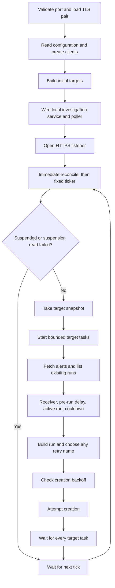
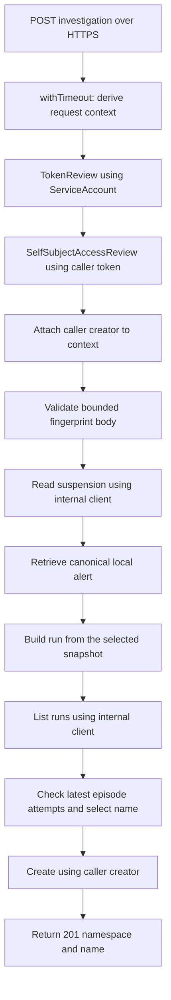

# Reconcile Flow

## Module Map

| File | Key symbols | Role |
|---|---|---|
| `cmd/alerts-adapter/main.go` | `main`, `run`, `newTargets`, `startServer`, `startSpokeClusterController` | Validate TLS, load settings, create clients, discover targets, coordinate HTTPS and polling |
| `internal/config/config.go` | `LoadFromFile`, `DefaultConfigPath` | Parse the startup file and apply defaults |
| `internal/adapter/adapter.go` | `Run`, `reconcile`, `reconcileTarget` | Schedule cycles and process each target |
| `internal/adapter/server.go` | `NewInvestigationServer` | Configure HTTPS routing and connection bounds |
| `internal/adapter/middleware.go` | `withTimeout`, `AuthMiddleware` | Derive the request deadline and attach the caller's creator |
| `internal/adapter/auth.go` | `Authorize`, `logError` | Authenticate, authorize, isolate caller clients, and categorize failures |
| `internal/adapter/handler.go` | `NewInvestigationHandler`, `Investigator` | Parse the bounded body, invoke the service, and encode the response |
| `internal/adapter/investigation.go` | `InvestigationService`, `Investigate`, `nextRunName` | Retrieve the canonical local alert, check the episode, and create with caller identity |
| `internal/agenticrun/build.go` | `BuildForTarget`, `StableFingerprint`, `NextAvailableName`, `ShortenName` | Build run metadata and request |
| `internal/multicluster/registry.go` | `Registry`, `Targets` | Protect the target map and return snapshots |
| `internal/multicluster/controller.go` | `Reconcile` | Rebuild or remove targets after SpokeCluster events |

## Data Flow

`run` validates `HTTP_PORT` and loads the required TLS certificate/key pair before reading configuration or creating Kubernetes clients. It then loads `/etc/alerts-adapter/config.yaml` once. Invalid YAML or duration syntax exits before client setup. The poller and independent investigation service receive the loaded configuration value; there is no configuration source interface or reload path.

`startServer` opens the listener and serves TLS using the preloaded certificate while the poller runs with the same process context. Serving failures cancel that context. After the poller returns, graceful HTTP shutdown has a five-second deadline; failure falls back to closing the server. The certificate watcher reloads mounted certificate updates for new connections.

`Run` calls `reconcile` immediately, then creates a ticker. Each reconcile reads the suspension state, performs backoff garbage collection, and takes a registry snapshot. A semaphore bounds target goroutines. Each task gets a context with a deadline of `pollInterval`; a wait group prevents overlapping cycles. Ticker events can be delayed or dropped when work is slow, so this is not a guaranteed delay after each completed cycle.

Within a target, alerts are processed in sequence. Retrieval or listing failure ends that target's work. A build or creation failure normally skips only that alert; timeout or cancellation ends the target task. Successful creation appends the run to the local list so another alert in the same group is blocked during that cycle.

## API Request Flow

Each failed step returns its mapped HTTP error without starting later operations. Authentication precedes body parsing and internal reads. `withTimeout` derives one 20-second deadline from the incoming context; auth, handler, and service preserve it and caller cancellation. The private context value carries a request-scoped creator, not a separately stored bearer token.

The handler depends on `Investigator`, implemented by `InvestigationService`, rather than the poller. The service receives the fixed local target, suspension reader, configuration, and logger at startup. It does not select spokes or access polling backoff; if the local target is unavailable after the suspension check, it fails with a generic internal error.

The service retrieves AlertManager once and builds from that canonical snapshot. Internal reads use existing clients; final creation uses the caller's isolated client. Kubernetes rechecks authorization and admission. No failure falls back to ServiceAccount creation.

`nextRunName` matches group and episode across original, qualified, and legacy retry names. It evaluates all attempts at the maximum creation timestamp and passes the selected unsuffixed base plus all returned names to `NextAvailableName`. Kubernetes AlreadyExists resolves snapshot races as API conflicts, without a shared API/poller lock. `ShortenName` is shared by retry generation and episode matching so both preserve the same hash and group qualifier.

Detailed selection, authentication precedence, and HTTP errors are defined in [investigation API](../what/investigation-api.md). Numerical listener bounds and TLS deployment settings are defined in [configuration](../what/configuration.md#https-listener).

## Key Abstractions

- `AlertSource`, `AgenticRunClient`, and `SuspensionSource` provide external reads and writes.
- `AgenticRunRequest` authenticates and authorizes API callers; `AgenticRunCreator` restricts the request-scoped creation dependency.
- `Investigator` is the handler's service interface. `InvestigationService` implements it independently of `Adapter`.
- `TargetSource` provides a snapshot. The registry combines fixed local targets with spoke targets behind a mutex.
- Polling `flowcontrol.Backoff` holds creation failures by target name and stable group hash. Delays grow from one minute to ten minutes. A nil creation error clears the entry, including AlreadyExists. Process restart clears all entries. API investigations never use this state.
- `BuildForTarget` renders `request.tmpl` with selected, sanitized alert fields. Agent selection uses step override, global override, then `default`.
- Names use alert name, optional namespace, and the first eight hex characters of SHA-256 over UTC RFC 3339 startsAt plus the target identity when present. Stable group hashes use sorted labels with ignored labels removed. The two hashes have different roles.

## Integration Points

| Consumer | Provider | Mechanism |
|---|---|---|
| Adapter startup | Deployment owner | YAML file mounted at `/etc/alerts-adapter/config.yaml` |
| HTTPS listener | OpenShift Service CA / deployment owner | Serving-certificate Secret mounted read-only; pair loaded at startup |
| API caller | Adapter | Bearer-authenticated HTTPS POST through the internal Service |
| Auth middleware | Kubernetes | ServiceAccount TokenReview followed by caller-authenticated SelfSubjectAccessReview |
| Investigation service | AlertManager / Kubernetes | Internal reads followed by caller-authenticated run creation |
| Poll loop | AlertManager | Authenticated HTTPS requests through the generated API client |
| Poll loop | Kubernetes | List/create AgenticRuns and read suspension state |
| Target controller | Hub resources | Watch SpokeClusters and read referenced credential Secrets |

## Implementation Notes

- A registry update affects later snapshots. It does not cancel tasks from an earlier snapshot.
- The controller watches SpokeClusters only. Credential Secret changes and connection failures do not directly trigger a refresh. A later SpokeCluster reconcile or process restart reloads credentials.
- Single-cluster local listing and multicluster local listing use different label filters. Switching modes can lose local deduplication history; [building rule 31a](../what/agenticrun-building.md#agenticrun-crud) records the missing compatibility.
- `terminalTime` maps Completed to Verified. It currently misses Completed runs produced by Analyzed with reason NoActionRequired; see [polling rule 25a](../what/poll-loop.md#post-run-delay-cooldown).
- `buildName` shortens only the alert-name component and can exceed 63 characters for long namespaces. [Building rule 16a](../what/agenticrun-building.md#metadata-sanitization) records the remaining requirement.
- `requestData.Summary` is populated but not used by `request.tmpl`. Summary is stored in metadata; description is included in the request.
- In polling, clearing cooldown does not change a deterministic name. An existing base name still causes AlreadyExists unless the EmergencyStopped replacement path chooses a retry name. API terminal-attempt retries follow their separate episode rules.
- The API derives terminal state directly from conditions; the polling cooldown gap for analysis-only completion does not prevent a manual retry of a terminal episode.
- API errors retain generic client responses while dependency logging records operation/category and available status codes, not raw diagnostic text.
